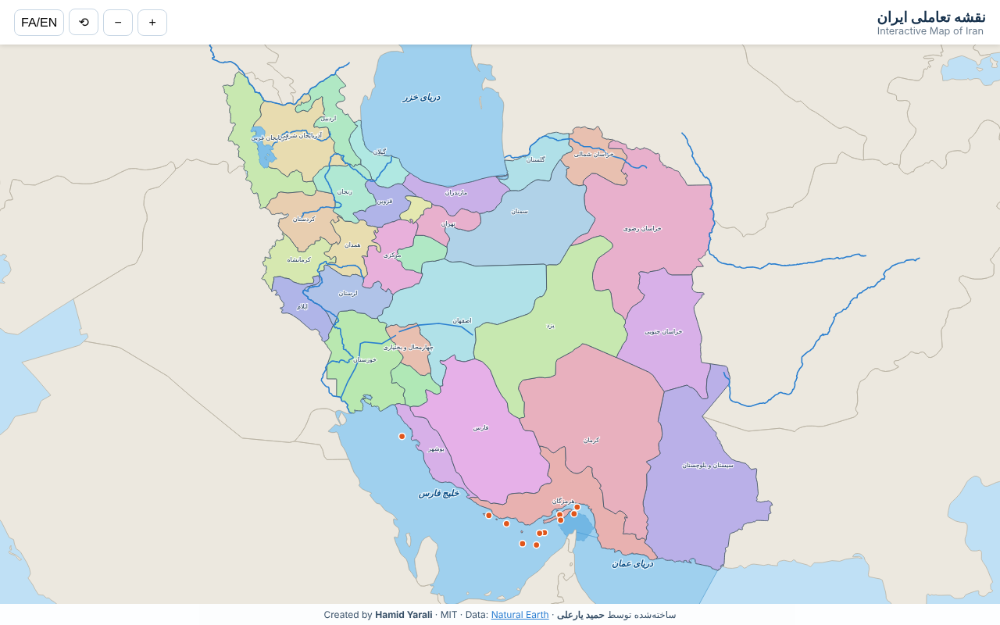
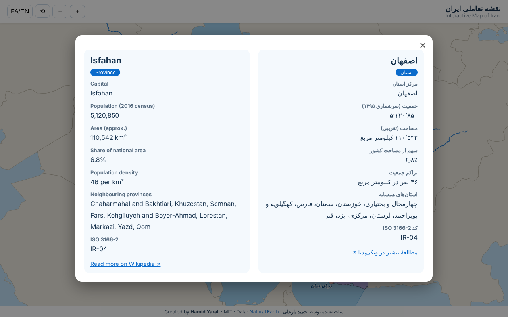

<div align="center">

# 🗺️ نقشه تعاملی ایران · Interactive Map of Iran

**[فارسی](#فارسی) · [English](#english)**



</div>

---

## فارسی

نقشهٔ تعاملی و بدون وابستگی (Vanilla JS + SVG) از **۳۱ استان ایران**، **دریای خزر، خلیج فارس، تنگهٔ هرمز، دریای عمان**، دریاچهٔ ارومیه، **جزایر** و **رودهای** اصلی. روی هر بخش کلیک کنید تا مشخصات آن به‌صورت **دوزبانهٔ فارسی و انگلیسی** در یک مودال نمایش داده شود.



### ویژگی‌ها
- مرزبندی استان‌ها با رنگ‌های جدا و برچسب نام‌ها
- مودال دوزبانه: مرکز استان، جمعیت (سرشماری ۱۳۹۵)، مساحت، سهم از مساحت کشور، تراکم، استان‌های همسایه (محاسبه‌شده از هندسهٔ نقشه) و پیوند به ویکی‌پدیا
- دریاها، تنگهٔ هرمز، دریاچه، ۱۱ جزیرهٔ مهم و ۱۱ رود
- زوم با چرخ ماوس، کشیدن (Pan)، دکمه‌های زوم و تغییر زبان برچسب‌ها (FA/EN)

### اجرا
```bash
git clone https://github.com/<your-username>/iran-interactive-map.git
cd iran-interactive-map
# فایل index.html را باز کنید، یا:
python3 -m http.server 8000   # سپس http://localhost:8000
```
برای انتشار روی **GitHub Pages**: Settings ← Pages ← شاخهٔ `main` و پوشهٔ root.

### ساختار پروژه
| مسیر | توضیح |
|---|---|
| `index.html`, `style.css`, `app.js` | رابط کاربری و منطق نقشه |
| `data/info.js` | اطلاعات دستی (استان‌ها، دریاها، جزایر، رودها) — برای افزودن مورد جدید همین‌جا ویرایش کنید |
| `data/geo.js` | مسیرهای SVG تولیدشده از Natural Earth |
| `tools/build_geo.py` | بازتولید `geo.js` (`python3 tools/build_geo.py`) |

### نکته‌ها
- مرزها از [Natural Earth](https://www.naturalearthdata.com/) (دامنهٔ عمومی) است؛ مساحت‌ها از روی همین هندسه محاسبه شده و **تقریبی** است. جمعیت‌ها تقریبی و از سرشماری ۱۳۹۵ است.
- مسیر رودهای کارون و زاینده‌رود **شماتیک** است. جزایر به‌صورت نقطه نمایش داده می‌شوند و فهرست آن‌ها قابل گسترش است.
- مشارکت (Pull Request) برای تکمیل اطلاعات و افزودن جزایر و رودهای بیشتر پذیرفته می‌شود.

---

## English

A dependency-free (Vanilla JS + SVG) interactive map of Iran's **31 provinces**, the **Caspian Sea, Persian Gulf, Strait of Hormuz, Gulf of Oman**, Lake Urmia, major **islands** and **rivers**. Click any feature to open a **bilingual (Persian / English)** details modal.

### Features
- Province borders with distinct colours and labels
- Bilingual modal: capital, population (2016 census), area, share of national area, density, neighbouring provinces (computed from the geometry) and a Wikipedia link
- Seas, the Strait of Hormuz, a lake, 11 notable islands and 11 rivers
- Mouse-wheel zoom, drag to pan, zoom buttons and label-language toggle (FA/EN)

### Run
```bash
git clone https://github.com/<your-username>/iran-interactive-map.git
cd iran-interactive-map
# open index.html, or:
python3 -m http.server 8000   # then visit http://localhost:8000
```
Deploy on **GitHub Pages**: Settings → Pages → branch `main`, root folder.

### Project structure
| Path | Description |
|---|---|
| `index.html`, `style.css`, `app.js` | UI and map logic |
| `data/info.js` | Hand-written reference data — edit here to add features |
| `data/geo.js` | SVG paths generated from Natural Earth |
| `tools/build_geo.py` | Regenerates `geo.js` (`python3 tools/build_geo.py`) |

### Notes
- Geometry comes from [Natural Earth](https://www.naturalearthdata.com/) (public domain); areas are computed from it and are **approximate**. Populations are approximate 2016-census figures.
- The Karun and Zayandeh Rud courses are **schematic**. Islands are shown as points, and the list can be extended.
- Pull requests that add islands, rivers or more details are welcome.

---

## 👤 Author · سازنده
**حمید یارعلی · Hamid Yarali**

## 📄 License · مجوز
[MIT](LICENSE) © 2026 Hamid Yarali
